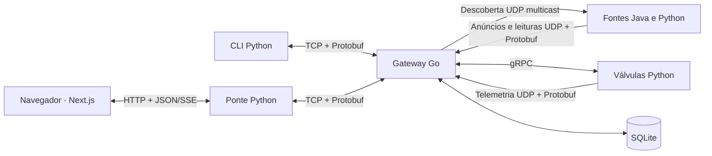

# AgroMesh — domínio e arquitetura

## Visão geral

Monitorar dois talhões de uma fazenda e permitir que um operador controle a irrigação
em uma única tela. Os dados são simulados; processos Go, Java e Python se integram por UDP multicast,
UDP, gRPC e TCP, todos com Protobuf.

## Processos e responsabilidades

| Componente | Linguagem | Responsabilidade |
|---|---|---|
| Gateway | Go | Descoberta, registro de fontes, ingestão, SQLite, consultas e proxy gRPC |
| Estação meteorológica | Java 21 | Temperatura, umidade do ar, vento e chuva |
| Sensor de solo (um por talhão) | Python | Telemetria periódica e alerta de solo seco |
| Válvula (uma por talhão) | Python | Estado, vazão, volume acumulado e serviço gRPC |
| Cliente CLI | Python | Listar, comandar, consultar e acompanhar eventos via TCP |
| Ponte do dashboard | Python | Traduzir a assinatura TCP em SSE/JSON e servir o build da interface |
| Interface web | Next.js + TypeScript (shadcn/ui) | Indicadores, séries, alertas, controle das válvulas e consultas |

## Contrato Protobuf

Contrato único: `proto/agro.proto`. Código gerado em `gen/go/agropb` e `gen/python`.

| Fluxo | Mensagens | Conteúdo |
|---|---|---|
| Descoberta | `DiscoveryRequest` | Endereço e porta UDP do gateway |
| Anúncio | `SourceInfo` em `UdpPacket` | Identidade, tipo, talhão, endereço, gRPC e configuração |
| Telemetria | `Reading` em `UdpPacket` | Timestamp em ms, métricas, indicador e texto de alerta |
| Requisição TCP | `ClientRequest` | `request_id` e uma operação: listar, comandar, consultar ou assinar |
| Resposta/evento TCP | `ServerMessage` | Fontes, resultado de comando/consulta, leitura ou erro |
| Estado das fontes | `SourceStatus`, `SourceList` | Última leitura, disponibilidade e metadados |
| Consulta | `QueryRequest`, `QueryResult`, `QueryRow` | Tipo, janela em minutos e valores agregados |

O TCP delimita cada mensagem com tamanho uint32 big-endian. Respostas usam o
`request_id` recebido; eventos da assinatura usam zero. Os campos `oneof` identificam
o conteúdo de cada envelope sem depender de convenções de texto.

## Serviço gRPC

`IrrigationValve` expõe `GetState(ValveStateRequest) → ValveState` e
`Configure(ValveCommand) → ValveState`.

`ValveCommand` tem campos opcionais `active`, `open`, `flow_lpm` e `interval_s`:
a presença distingue “não alterar” de valores como `false`. O retorno inclui identidade,
talhão, atividade, abertura, vazão, intervalo e litros acumulados. O gateway resolve a
fonte pelo registro e encaminha o comando; clientes não acessam as válvulas diretamente.
Desativar interrompe a telemetria, preservando o gRPC para permitir reativação.

## Funcionalidades

- Três tipos de fonte, cada instância em processo separado: estação, solo e válvula.
- Descoberta multicast e anúncios unicast; ingestão UDP com Protobuf.
- Solo amostrado a cada segundo; alerta imediato ao passar de úmido para abaixo de 25%.
- Controle gRPC de abertura, vazão, intervalo e falha simulada.
- Cliente separado via socket TCP, com listagem, comandos e quatro consultas.
- Histórico SQLite e dashboard com atualizações, mudanças de topologia e alertas.

## Consultas e limites

| Consulta | Cálculo na janela |
|---|---|
| Talhão mais seco | Menor média das amostras de umidade por talhão |
| Consumo de água | Soma, por talhão, de `máximo − mínimo` do contador de cada válvula |
| Temperatura | Média, desvio padrão populacional, mínimo e máximo por estação |
| Alertas | Contagem de eventos de seca por talhão |

UDP pode perder dados. O consumo é estimado pelas amostras disponíveis: uma única
amostra resulta em zero, e reinícios do contador dentro da janela comprometem a estimativa.
O histórico persiste no gateway; os contadores das válvulas ficam em memória.
A disponibilidade é inferida por ausência de leituras, sujeita a atrasos e perdas.
O gráfico do navegador mantém uma janela recente; consultas usam o histórico SQLite.
As simulações de solo e válvula são independentes: abrir irrigação não modifica o solo.
