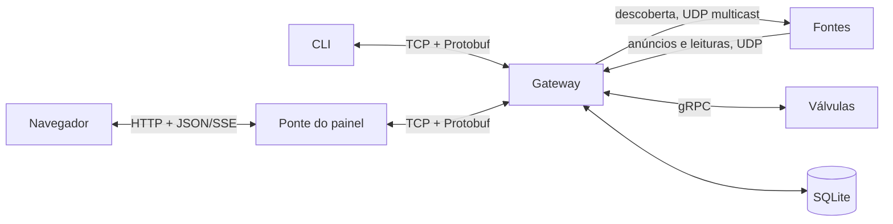

# Arquitetura

Este documento explica como as partes do AgroMesh se conectam e que mensagens trocam. Para entender o problema que o sistema resolve, leia antes [negocio.md](negocio.md). Os detalhes de cada programa estão em [servicos.md](servicos.md).

## Visão geral

O sistema é formado por vários programas independentes, que conversam pela rede. Cada programa é um processo, e no Docker cada um roda no seu próprio container (um ambiente isolado com tudo que o programa precisa).

| Programa | Linguagem | Papel |
|---|---|---|
| Gateway | Go | Centro do sistema. Encontra as fontes, recebe as medições, guarda o histórico e repassa os comandos. |
| Estação meteorológica | Java 21 | Fonte que envia temperatura, umidade do ar, vento e chuva. |
| Sensor de solo (um por talhão) | Python | Fonte que envia umidade e temperatura do solo e avisa quando a terra seca. |
| Válvula (uma por talhão) | Python | Fonte que pode ser comandada. Envia vazão e litros acumulados. |
| CLI | Python | Programa de terminal para listar fontes, comandar válvulas e fazer consultas. |
| Ponte do painel | Python | Liga o navegador ao Gateway e entrega a interface web. |
| Interface web | Next.js e TypeScript | O painel que aparece no navegador. |

Chamamos de fonte todo equipamento que produz dados, ou seja, a estação, os sensores e as válvulas.

O Gateway é o único ponto de contato. O CLI e o painel nunca falam direto com as fontes. Todo comando e toda consulta passam por ele.

## Formas de comunicação

As mensagens têm formato definido no arquivo `proto/agro.proto`. Elas são gravadas em Protobuf, um formato binário compacto que programas em Go, Java e Python leem do mesmo jeito. O sistema usa quatro formas de transporte, cada uma para uma tarefa.

| Transporte | Para que é usado | Por que esse |
|---|---|---|
| UDP multicast | O Gateway procurar as fontes. | Uma única mensagem chega a todos que escutam o mesmo endereço de grupo (`239.255.10.1:9999`), sem precisar saber quem são. |
| UDP | As fontes enviarem anúncios e medições ao Gateway (porta 9100). | É leve e rápido. Perder uma medição de vez em quando não prejudica o sistema. |
| gRPC | O Gateway mandar comandos às válvulas (portas 50061 e 50062). | É uma chamada remota com pergunta e resposta. O Gateway sabe se o comando foi aplicado e recebe o estado novo da válvula. |
| TCP | O CLI e a ponte do painel falarem com o Gateway (porta 9200). | A conexão é confiável e mantém a ordem. Serve para pedidos e para receber eventos ao vivo. |

## Os fluxos principais

### 1. Descoberta

As fontes não sabem o endereço do Gateway. Ele se apresenta primeiro.

1. Ao iniciar, e depois a cada 15 s, o Gateway envia um `DiscoveryRequest` ao grupo multicast. A mensagem diz o IP dele e a porta UDP onde quer receber dados.
2. Cada fonte que escuta o grupo guarda esse endereço e responde com um `SourceInfo`. Ele traz o nome, o tipo, o talhão, o IP e o intervalo de envio da fonte. Também traz a porta gRPC, que é zero quando a fonte não aceita comandos, e o estado inicial.
3. O Gateway registra a fonte e avisa os painéis conectados que a lista de fontes mudou.

Até receber a primeira descoberta, a fonte descarta as medições, porque ainda não sabe para onde mandar. A repetição a cada 15 s faz o Gateway encontrar também as fontes que ligam depois dele ou que reiniciam.

### 2. Telemetria

Telemetria é o envio contínuo de medições.

1. Cada fonte envia uma `Reading` por UDP no seu intervalo. A leitura leva o nome da fonte, o talhão, a hora e um conjunto de métricas, como `moisture_pct` ou `flow_lpm`.
2. Anúncios e leituras chegam na mesma porta. Os dois vêm dentro de um `UdpPacket`, que diz qual dos dois está dentro.
3. O Gateway atualiza a última leitura da fonte, grava as métricas no banco e repassa a leitura aos painéis conectados.

O sensor de solo verifica a umidade a cada segundo. As leituras periódicas, porém, só saem no intervalo configurado. Quando a umidade cai abaixo de 25%, ele envia na hora uma leitura marcada como alerta. Depois disso, ele só volta a alertar quando a umidade sobe 2 pontos acima do limite. Assim o ruído da medição não gera vários alertas seguidos.

### 3. Detecção de falha

O Gateway não pergunta às fontes se elas estão vivas. Ele observa o silêncio. A cada 2 s, ele marca como offline a fonte que ficou sem enviar nada por três intervalos seguidos, com mínimo de 6 s. A fonte volta a aparecer como online assim que chega a próxima leitura.

### 4. Comando a uma válvula

1. O CLI ou o painel envia ao Gateway um `CommandRequest` com o nome da válvula e o comando.
2. O Gateway procura a válvula no registro e chama o método `Configure` do serviço gRPC `IrrigationValve`.
3. A válvula aplica o comando e responde com o `ValveState` completo.
4. O Gateway atualiza o registro e responde ao pedido com um `CommandResult`.

O `ValveCommand` tem quatro campos opcionais, que são `active`, `open`, `flow_lpm` e `interval_s`. A válvula muda só o que veio preenchido. Assim, um comando que só abre a válvula não zera a vazão por engano.

Desativar a válvula (`active = false`) simula um defeito. Ela para de enviar telemetria e corta a água, mas o serviço gRPC continua no ar para que ela possa ser reativada.

### 5. Consulta ao histórico

O CLI ou o painel envia um `QueryRequest` com o tipo de consulta e a janela de tempo em minutos. O Gateway calcula a resposta no banco e devolve um `QueryResult` com um resumo em texto e uma tabela.

| Consulta | Como é calculada na janela |
|---|---|
| Talhão mais seco | Menor média de umidade por talhão. |
| Consumo de água | Por válvula, o maior menos o menor valor do contador de litros. Os resultados são somados por talhão. |
| Temperatura | Média, desvio padrão, mínimo e máximo por estação. |
| Alertas | Número de alertas de solo seco por talhão. |

### 6. Painel ao vivo

O navegador não entende Protobuf sobre TCP. Por isso a ponte do painel fica no meio.

1. A ponte abre uma conexão TCP com o Gateway e assina os eventos. A partir daí, o Gateway empurra para ela cada leitura nova e cada mudança na lista de fontes.
2. O navegador abre `/events` na ponte. Ela responde com SSE (Server-Sent Events), uma conexão HTTP que fica aberta e recebe eventos em texto.
3. Comandos e consultas do painel chegam na ponte por `/api/command` e `/api/query`, em JSON. A ponte transforma cada um num pedido TCP ao Gateway.

## Protocolo TCP

Cada mensagem TCP vai precedida de 4 bytes com o tamanho dela, em ordem *big-endian*. Isso é necessário porque o TCP entrega um fluxo contínuo de bytes, sem marcar onde uma mensagem termina e a próxima começa.

O cliente envia um `ClientRequest` com um número de pedido (`request_id`) e uma operação. As operações são listar fontes, comandar uma válvula, fazer uma consulta ou assinar eventos. O Gateway responde com um `ServerMessage` que repete o mesmo número. Os eventos empurrados depois de uma assinatura chegam com `request_id` zero.

## Armazenamento

O Gateway guarda tudo num arquivo SQLite, um banco de dados que não precisa de servidor próprio. No Docker, esse arquivo fica no volume `gateway-data`, por isso o histórico sobrevive quando o sistema é desligado.

Há duas tabelas. A `readings` tem uma linha por métrica de cada leitura, com hora, fonte, tipo, talhão, nome da métrica e valor. Esse formato permite calcular qualquer grandeza com a mesma consulta SQL. A `alerts` guarda cada alerta de solo seco com a mensagem.

## Limitações

- UDP pode perder pacotes, e as consultas trabalham só com o que chegou.
- O contador de litros fica na memória da válvula. Se ela reiniciar dentro da janela, o consumo calculado sai errado.
- A detecção de falha se baseia em silêncio. Uma fonte lenta e uma fonte parada só se diferenciam pelo tempo.
- As simulações são independentes. Abrir uma válvula não altera a umidade do solo.
- Os serviços usam a rede do próprio computador no Docker (`network_mode: host`), porque a rede padrão do Docker não repassa multicast. Por isso o sistema roda em Linux.
