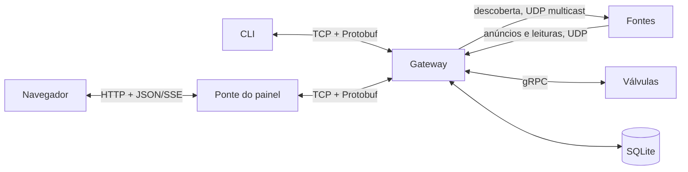

# Arquitetura

A fazenda tem dois talhões, cada um com um sensor de umidade do solo e uma válvula de
irrigação, e uma estação meteorológica na sede. Os dados são simulados. Todo o tráfego entre
processos usa Protobuf, sobre UDP multicast, UDP, gRPC ou TCP.

| Componente | Linguagem | Papel |
|---|---|---|
| Gateway | Go | Descoberta, registro de fontes, ingestão, SQLite, consultas e proxy gRPC |
| Estação meteorológica | Java 21 | Temperatura, umidade do ar, vento e chuva |
| Sensor de solo (um por talhão) | Python | Umidade e temperatura do solo; alerta de solo seco |
| Válvula (uma por talhão) | Python | Vazão e volume acumulado; servidor gRPC |
| CLI | Python | Lista fontes, envia comandos, consulta e acompanha leituras |
| Ponte do painel | Python | Converte a assinatura TCP em SSE/JSON e serve a interface |
| Interface web | Next.js + TypeScript | Painel com indicadores, gráficos, alertas, comandos e consultas |

Clientes nunca falam com as fontes: comandos e consultas sempre passam pelo gateway.

## Descoberta e telemetria

O gateway envia um `DiscoveryRequest` ao grupo multicast ao iniciar e depois a cada 15 s,
para encontrar também as fontes que sobem mais tarde ou reiniciam. Cada fonte responde com
um `SourceInfo` por UDP unicast: tipo, talhão, IP, porta gRPC (zero quando não é
controlável) e estado inicial. Até receber a primeira descoberta, a fonte não conhece o
gateway e descarta as leituras.

As leituras chegam como `Reading` no mesmo socket UDP dos anúncios, ambos dentro de um
`UdpPacket`. Uma fonte passa a constar como offline quando fica sem enviar dados por três
intervalos, com mínimo de 6 s, e volta a constar como online na leitura seguinte.

O sensor de solo amostra a cada segundo e envia leituras periódicas. Quando a umidade cai
abaixo de 25%, envia na hora uma leitura marcada como alerta. Para o ruído da medição não
gerar uma rajada de alertas, ele só volta a alertar depois que a umidade sobe 2 pontos
acima do limiar.

## Serviço gRPC

`IrrigationValve` tem dois métodos: `GetState` e `Configure`. O `ValveCommand` usa campos
`optional` (`active`, `open`, `flow_lpm`, `interval_s`) para que a válvula altere só o que
veio preenchido, distinguindo "não mexer" de `false` ou zero. A resposta é o `ValveState`
completo.

Desativar uma válvula (`active = false`) interrompe a telemetria e fecha o fluxo de água,
mas mantém o servidor gRPC no ar para que ela possa ser reativada.

## Protocolo TCP

Cada mensagem é precedida por 4 bytes big-endian com o tamanho do payload. O cliente envia
`ClientRequest` com um `request_id` e uma operação: listar fontes, comandar uma válvula,
consultar o histórico ou assinar eventos. O gateway responde com `ServerMessage` usando o
mesmo `request_id`. Depois de uma assinatura, a conexão também recebe leituras e mudanças
de topologia com `request_id` zero.

## Consultas

| Consulta | Cálculo na janela |
|---|---|
| Talhão mais seco | Menor média de umidade por talhão |
| Consumo de água | Soma, por talhão, de máximo − mínimo do contador de litros de cada válvula |
| Temperatura | Média, desvio padrão populacional, mínimo e máximo por estação |
| Alertas | Número de alertas de solo seco por talhão |

O histórico é gravado em formato longo, com uma linha por métrica, para que qualquer
grandeza seja agregada com o mesmo SQL.

## Limitações

- UDP pode perder pacotes, e as consultas trabalham só com o que chegou.
- O contador de litros fica em memória na válvula. Se ela reiniciar dentro da janela, o
  consumo calculado fica errado.
- A detecção de falha se baseia em silêncio, então uma fonte lenta e uma fonte morta só
  se diferenciam pelo tempo.
- As simulações são independentes: abrir uma válvula não altera a umidade do solo.
